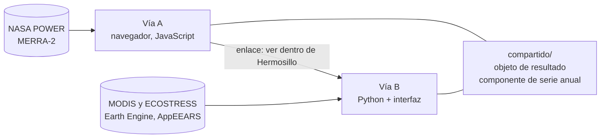

# SunCity · Sonora Calor

Herramienta para responder **qué variable climática cambia en una región, cuánto por década y si el cambio es significativo**. Proyecto del equipo para NASA Space Apps Challenge 2026, sede Hermosillo (14 y 15 de noviembre de 2026).

> **Estado al 14 de noviembre de 2026:** repositorio recién iniciado. Este repositorio todavía no contiene resultados sobre Hermosillo. Los únicos números locales citados en la documentación vienen de López González y otros (2021).

## Qué se entrega

Una sola herramienta con dos niveles que comparten el mismo cálculo de tendencia.

| | Vía A: herramienta a escala | Vía B: Hermosillo |
|---|---|---|
| Desarrollador | Navarrete | Mario |
| Pregunta | ¿Qué variable cambia en mi región, cuánto, y es significativo? | ¿Qué sectores se calientan de noche más rápido que su desierto? |
| Datos | NASA POWER (MERRA-2), 1981 a hoy, sin clave | MODIS a 1 km, 2001-2019; ECOSTRESS a 70 m |
| Escala | Celda de reanálisis: no distingue una ciudad | Sector de 9 km² o más |
| Cálculo | Theil-Sen + Mann-Kendall en el navegador | La misma función en Python, con variantes y FDR |

El pitch vende la Vía A; el trabajo científico vive en la Vía B.



## Documentación

| Documento | Contenido |
|---|---|
| [docs/01-PLAN.md](docs/01-PLAN.md) | Decisión, alcance, equipo, riesgos, qué no se afirma |
| [docs/02-FASES.md](docs/02-FASES.md) | Fases, puertas, entregables, pruebas de aceptación, orden de recorte |
| [docs/03-ARQUITECTURA.md](docs/03-ARQUITECTURA.md) | Diagramas: componentes, flujos, contrato entre vías, carpetas |
| [docs/04-DATOS-Y-APIS.md](docs/04-DATOS-Y-APIS.md) | Productos, identificadores, filtros de calidad, estado de verificación |
| [docs/05-MODELOS.md](docs/05-MODELOS.md) | Modelos A a J, fórmulas, potencia estadística, variantes |
| [docs/DECISIONES.md](docs/DECISIONES.md) | Registro de decisiones. **Se llena antes de calcular la primera tendencia** |
| [docs/SunCity-Documentacion.pdf](docs/SunCity-Documentacion.pdf) | Todo lo anterior en un solo PDF |

## Estructura del repositorio

```text
SunCity/
├── README.md
├── requirements.txt
├── docs/                  Plan, fases, arquitectura, datos, modelos, decisiones, PDF
├── compartido/            Lo que usan las dos vías
│   └── tendencia.py       Función de referencia (Theil-Sen, Mann-Kendall, FDR)
├── via-a/                 Herramienta a escala (navegador + NASA POWER)
└── via-b/                 Hermosillo: export, series, resultados, interfaz
```

## Primeros pasos

Desde la raíz del repositorio:

```bash
python servir.py
```

- Vía A: <http://localhost:8000/via-a/>
- Vía B: <http://localhost:8000/via-b/>

Pruebas de la estadística:

```bash
pip install -r requirements.txt
python via-a/pruebas/generar_casos.py
node via-a/pruebas/probar_tendencia.cjs
```

## Equipo

| Persona | Responsabilidad |
|---|---|
| Navarrete | Vía A (terminada); estadística y `DECISIONES.md`; datos de la Vía B en Earth Engine y AppEEARS; estación de aire |
| Mario | Vía B: mapa, expediente por sector, semáforo y componente de serie anual compartido |

El equipo son dos personas. Los roles que el plan v5 daba a Carlos (estadística), Ángel Díaz (datos) y Emilio (estación y segunda ciudad) pasan a Navarrete, porque la Vía A ya está lista.

## Puertas

| Cuándo | Vía A | Vía B |
|---|---|---|
| Sáb 13:00 | Serie de Hermosillo dibujada desde POWER | Mapa y expediente con datos de prueba en el formato fijo |
| Sáb 17:00 | Theil-Sen y Mann-Kendall en JavaScript, iguales a Python; cinco variables con definición | Interfaz leyendo `serie.csv` real; barras del ciclo diario |
| Sáb 22:00 | Flujo de tres preguntas completo; segunda ciudad cargada | Primer `resultados.csv` conectado; curva de variantes |
| Dom 12:00 | Enlace hacia la Vía B; pruebas de aceptación | Pruebas de aceptación de v4 |
| Dom 15:00 | Funciones congeladas | Funciones congeladas |
| Dom 20:00 | Envío | Envío |

## Reglas del proyecto

1. Ninguna tendencia se calcula antes de registrar sus reglas en `docs/DECISIONES.md`.
2. Las dos vías devuelven el mismo objeto de resultado: `n_anios`, `pendiente_c_decada`, `ic95_inf`, `ic95_sup`, `p`.
3. Los CSV de v4 no cambian de nombre ni de columnas.
4. Una tendencia no significativa se muestra igual: veredicto gris con pendiente e intervalo.
5. No se afirma que Hermosillo sea un oasis de día frente a su desierto hasta tener el Modelo J, ni que el proyecto mida salud o temperatura del aire. Lista completa en [docs/01-PLAN.md](docs/01-PLAN.md#7-lo-que-no-se-afirma).

## Fuente de esta documentación

Sonora Calor, Plan v5 (14 de noviembre de 2026). El Plan v4 (PDF del 10 de noviembre) no está en el repositorio; lo que depende de él está marcado como "definido en v4" en cada documento.
