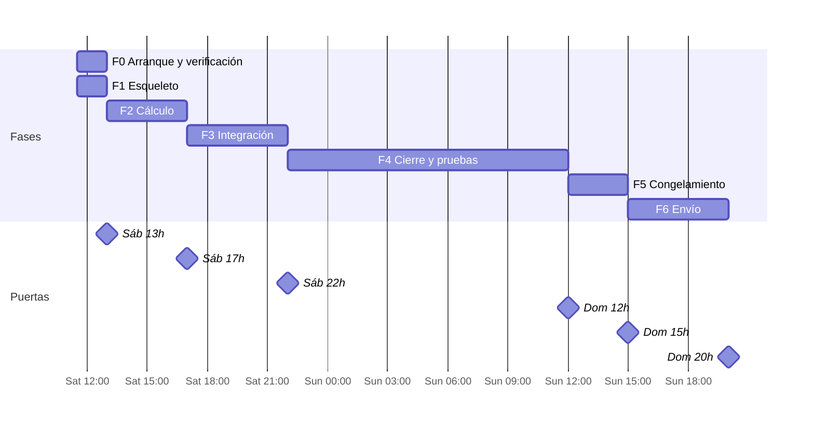
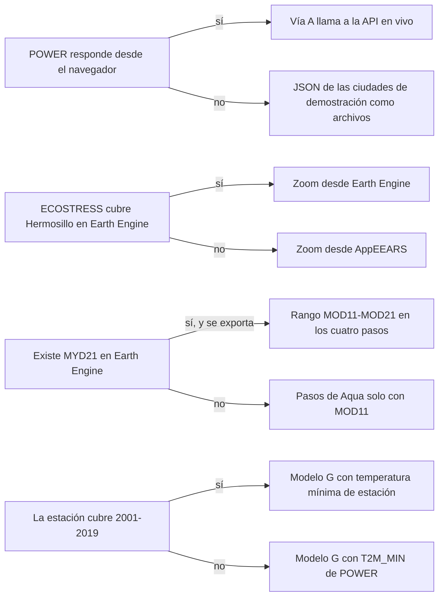
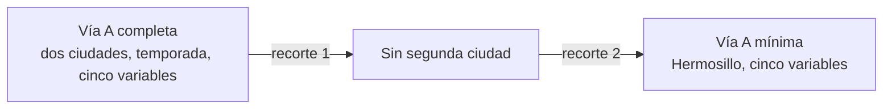

# 2. Fases y puertas

Cada fase termina en una **puerta**: una hora fija y algo que se puede mostrar funcionando. Si una puerta no se cumple, se aplica el orden de recorte del final; no se mueve la hora. Horas en tiempo de Hermosillo, sábado 14 y domingo 15 de noviembre de 2026.

## Resumen

| Fase | Termina | Vía A (Navarrete) | Vía B (Mario) |
|---|---|---|---|
| 0. Arranque y verificación | Primera hora | Llamada de POWER probada | Conteos de datos y función de referencia probada |
| 1. Esqueleto | Sáb 13:00 | Serie de Hermosillo dibujada desde POWER | Mapa y expediente con datos de prueba en el formato fijo |
| 2. Cálculo | Sáb 17:00 | Theil-Sen y Mann-Kendall en JavaScript, iguales a Python; cinco variables con definición | Interfaz leyendo `serie.csv` real; barras del ciclo diario |
| 3. Integración | Sáb 22:00 | Flujo de tres preguntas completo; segunda ciudad cargada | Primer `resultados.csv` conectado; curva de variantes |
| 4. Cierre y pruebas | Dom 12:00 | Enlace "ver dentro de Hermosillo"; pruebas de aceptación | Pruebas de aceptación de v4 |
| 5. Congelamiento | Dom 15:00 | Funciones congeladas | Funciones congeladas |
| 6. Envío | Dom 20:00 | Envío | Envío |

## Fase 0. Arranque y verificación

**Objetivo.** Confirmar que cada fuente de datos responde como se espera, antes de construir sobre ella. Corre en paralelo con la Fase 1.

Comprobaciones de la primera hora:

- [ ] **Navarrete:** la llamada de POWER responde desde el navegador.
- [ ] **Ángel Díaz:** contar escenas de ECOSTRESS sobre Hermosillo en Earth Engine. La solicitud de AppEEARS se lanza de todos modos.
- [ ] **Ángel Díaz:** contar noches válidas de `MOD21A1N` en la temporada de un año, y confirmar si existe MYD21 en Earth Engine.
- [ ] **Emilio:** qué años cubre la estación de Hermosillo en SMN y en Climate Data Online.
- [ ] **Carlos:** correr la función de referencia con una serie inventada (`python compartido/tendencia.py`).

Se registra en `DECISIONES.md` **antes de la primera tendencia**:

- [ ] La variante `sin_2001_2002` y si cuenta para el semáforo.
- [ ] Cómo se promedia MOD21 diario en la temporada y el mínimo de noches válidas.
- [ ] Si el ciclo diario usa MYD21 o solo MOD11 en los pasos de Aqua.
- [ ] En la Vía A: lista de variables, regla de año completo o mes fijo, y que el p se muestra sin ajuste.
- [ ] El mínimo real de años (`min_anios`), que fija Carlos.

**Criterio de salida.** Cada comprobación tiene respuesta escrita (sí, no, o plan B activado) y las cinco decisiones están registradas.

## Fase 1. Esqueleto (puerta: sábado 13:00)

**Objetivo.** Las dos interfaces existen y muestran algo, aunque sea con datos de prueba.

| | Vía A | Vía B |
|---|---|---|
| Tareas | Llamar a POWER para Hermosillo; convertir la respuesta en serie anual; dibujarla | Mapa de sectores; expediente con datos de prueba en el formato fijo; primer borrador del componente de serie anual |
| Entregable | Página que dibuja la serie de Hermosillo desde POWER | Mapa y expediente navegables con datos de prueba |
| Puerta | La serie de Hermosillo se ve en pantalla | El expediente abre desde el mapa y respeta el formato fijo |

Se confirma en la primera respuesta de POWER cómo vienen las llaves de mes y de promedio anual, y cuál es el valor de relleno.

## Fase 2. Cálculo (puerta: sábado 17:00)

**Objetivo.** El cálculo de tendencia funciona en las dos vías y da lo mismo.

| | Vía A | Vía B |
|---|---|---|
| Tareas | Theil-Sen con intervalo del 95 % y Mann-Kendall en JavaScript; cinco variables con definición de una línea | Interfaz leyendo `serie.csv` real; barras del ciclo diario (Modelo J) |
| Entregable | Resultado numérico junto a la serie | Expediente con datos reales y ciclo diario |
| Puerta | JavaScript y Python coinciden en la serie de prueba, a tres decimales | La interfaz lee `serie.csv` real y dibuja las cuatro barras |

Depende de la Fase 0: Carlos ya probó la función de referencia y Ángel Díaz ya entregó el primer `serie.csv`.

## Fase 3. Integración (puerta: sábado 22:00)

**Objetivo.** Cada vía hace su recorrido completo de principio a fin.

| | Vía A | Vía B |
|---|---|---|
| Tareas | Flujo de tres preguntas (dónde, qué variable, qué temporada); cargar la segunda ciudad; veredicto en lenguaje llano con etiqueta "exploratorio" | Conectar el primer `resultados.csv`; curva de variantes con cinco; semáforo y veredicto |
| Entregable | Herramienta usable por alguien externo | Expediente completo de al menos un sector |
| Puerta | Un usuario llega del mapa al veredicto sin ayuda | `resultados.csv` conectado y curva de variantes visible |

## Fase 4. Cierre y pruebas (puerta: domingo 12:00)

**Objetivo.** Las dos vías quedan unidas y pasan sus pruebas de aceptación.

Pruebas de aceptación de la Vía A:

- [ ] La llamada de POWER responde desde el navegador. Si el navegador la bloquea, se descargan una vez los JSON de las ciudades de demostración y se sirven como archivos.
- [ ] La misma serie da la misma pendiente en JavaScript y en la función de Python, a tres decimales.
- [ ] Se confirmó cómo vienen las llaves de mes y de promedio anual, y cuál es el valor de relleno.
- [ ] Cada variable muestra su definición y su fuente.
- [ ] El enlace "ver dentro de Hermosillo" lleva a la Vía B.
- [ ] El límite de escala se dice en pantalla.

Pruebas de aceptación de la Vía B: las que define v4, más estas que agrega v5:

- [ ] `resultados.csv` incluye la variante `sin_2001_2002`.
- [ ] El ciclo diario muestra cuatro pasos: rango MOD11-MOD21 en los de Terra y lo decidido en `DECISIONES.md` para los de Aqua.
- [ ] El signo diurno de Yale aparece junto a las barras de 10:30 y 13:30.
- [ ] El zoom ECOSTRESS aparece solo en el sector prioritario.

## Fase 5. Congelamiento (puerta: domingo 15:00)

**Objetivo.** Dejar de agregar funciones.

- Desde las 12:00 solo se corrigen errores y textos.
- A las 15:00 las funciones quedan congeladas en las dos vías.
- Se revisa que ningún texto en pantalla afirme algo de la lista "lo que no se afirma" de [01-PLAN.md](01-PLAN.md).

## Fase 6. Envío (puerta: domingo 20:00)

**Objetivo.** Entregar.

- Demostraciones grabadas: Hermosillo con `T2M_MIN` y la segunda ciudad.
- Pitch: vende la Vía A y usa la Vía B como profundidad científica. La frase del oasis solo entra si el Modelo J lo muestra.
- Envío antes de las 20:00.

Las guías de jueces y de envío no se han revisado. Conviene abrirlas el sábado para no descubrir requisitos el domingo.

## Orden de recorte

Si falta tiempo, se recorta en este orden:

1. La segunda ciudad de la Vía A.
2. El selector de temporada de la Vía A.

La Vía A mínima es Hermosillo con cinco variables. De la Vía B no se recorta nada que v4 marque como intocable.

