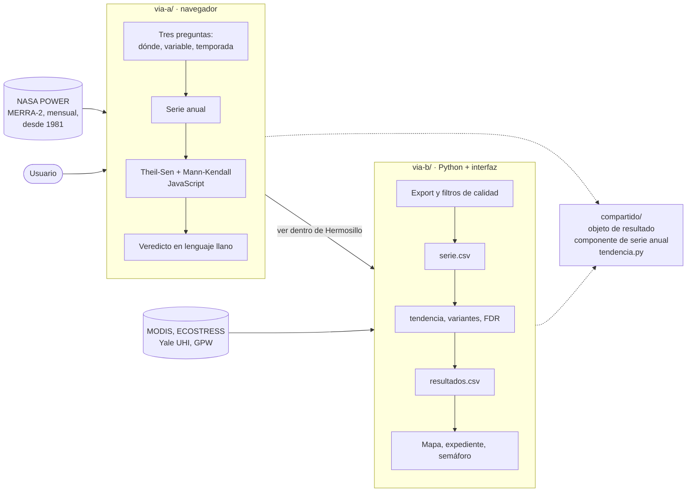
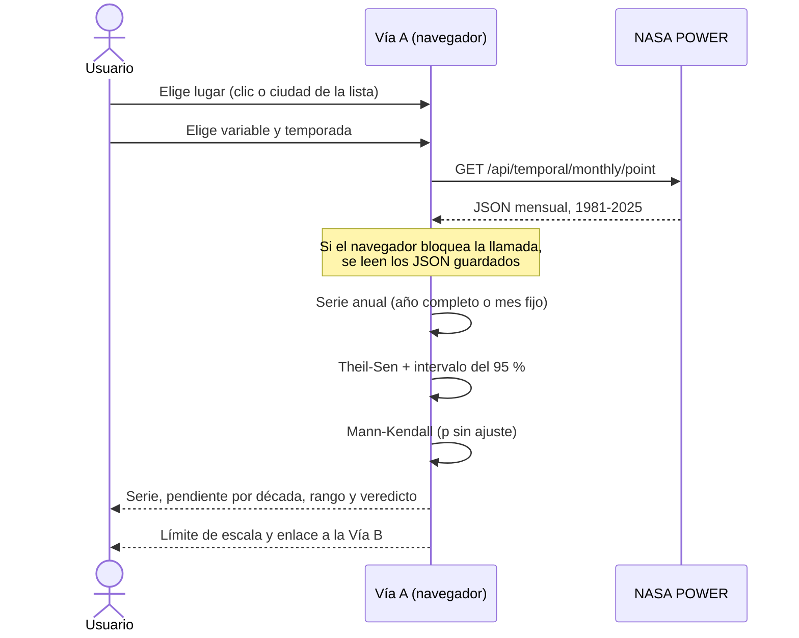
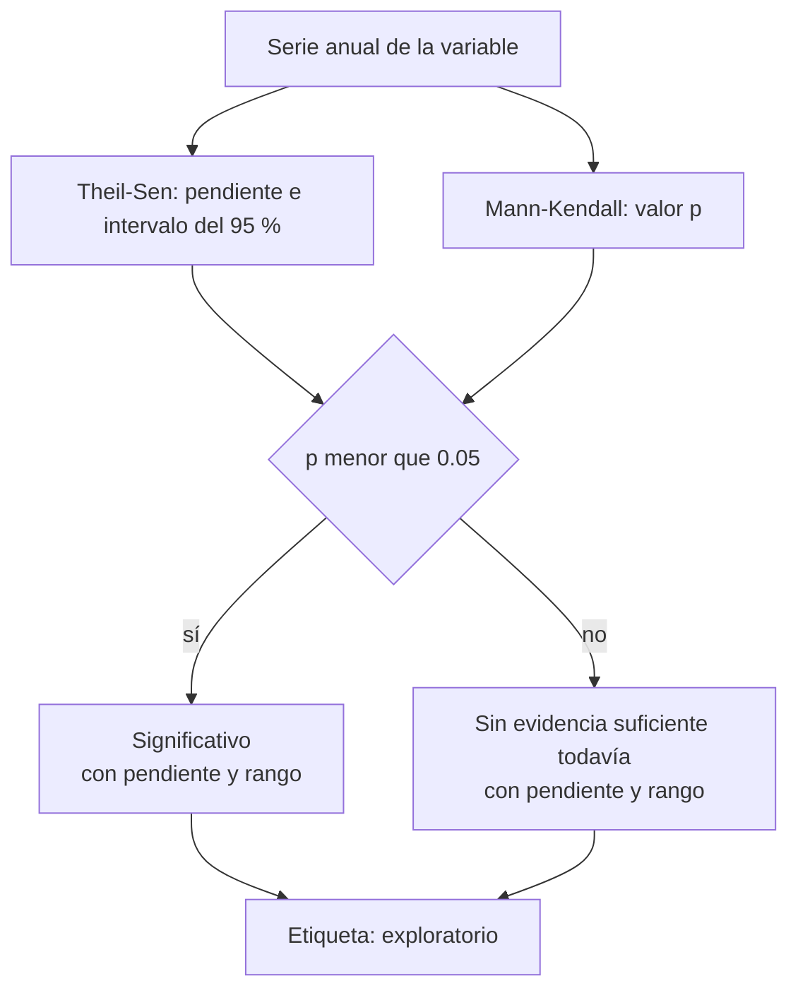
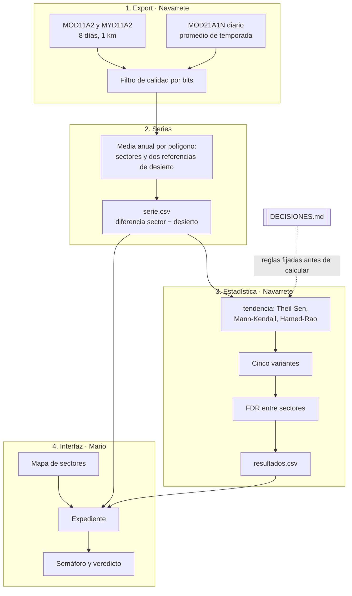
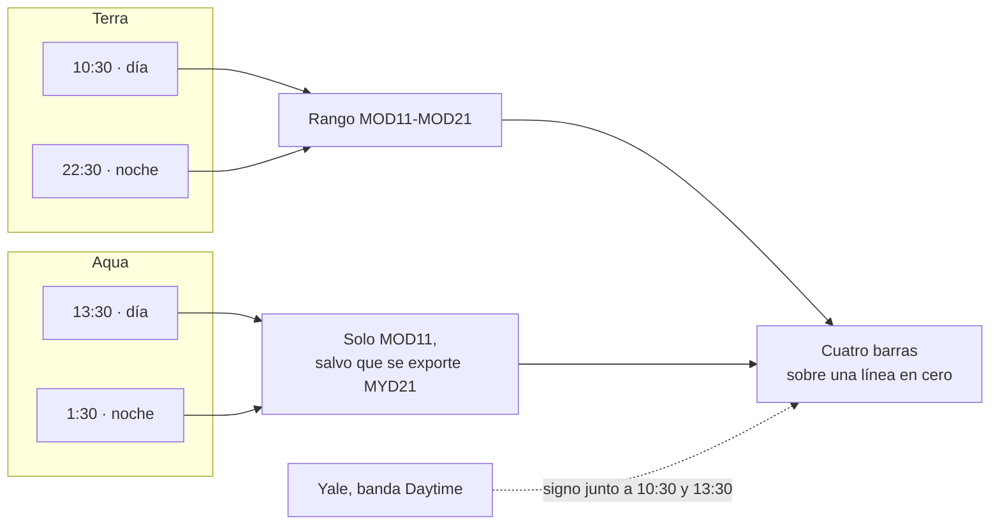
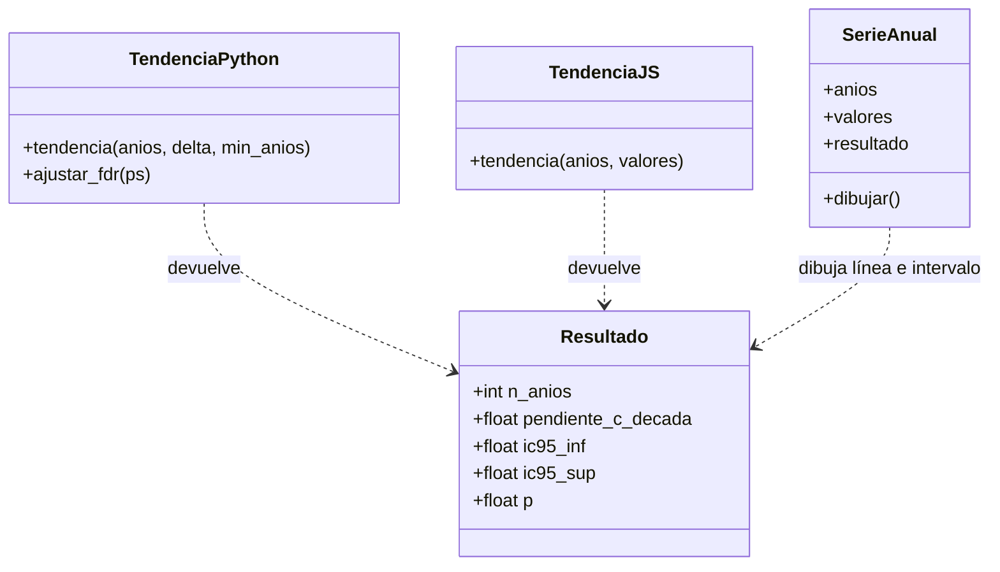
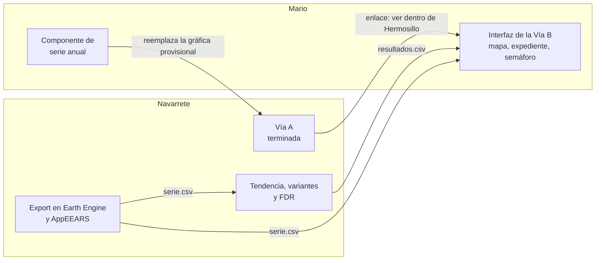

# 3. Arquitectura y diagramas

Las dos vías no comparten datos. Comparten la forma del resultado y un componente de gráfica. Con eso cada desarrollador avanza sin esperar al otro.

## 3.1 Vista general



## 3.2 Vía A: flujo de una consulta



## 3.3 Vía A: veredicto



## 3.4 Vía B: del satélite al expediente



## 3.5 Vía B: ciclo diario (Modelo J)

Media 2003-2019 de la diferencia sector − referencia A en cuatro horas de paso. Bajo cero es oasis; sobre cero es isla de calor.



## 3.6 Contrato entre vías

Objeto de resultado, idéntico en ambas vías:

| Campo | Tipo | Significado |
|---|---|---|
| `n_anios` | entero | Años válidos usados |
| `pendiente_c_decada` | número | Pendiente Theil-Sen por década |
| `ic95_inf` | número | Límite inferior del intervalo del 95 % |
| `ic95_sup` | número | Límite superior del intervalo del 95 % |
| `p` | número | Valor p que se reporta |

```json
{
  "n_anios": 19,
  "pendiente_c_decada": 0.0,
  "ic95_inf": 0.0,
  "ic95_sup": 0.0,
  "p": 1.0
}
```

Los valores del ejemplo son de relleno. En Python la función devuelve además `p_mk` y `p_hamed_rao`; `p` es el mayor de los dos. En la Vía A, `p` es el de Mann-Kendall sin ajuste. Para variables que no son temperatura (precipitación), el campo conserva el nombre y la interfaz muestra la unidad correcta.



Reglas del contrato:

- El componente de serie anual con línea de pendiente e intervalo lo hace Mario; Navarrete lo reutiliza.
- Los CSV de v4 no cambian de nombre ni de columnas.
- `resultados.csv` admite una variante más: `sin_2001_2002`.
- La misma serie debe dar la misma pendiente en JavaScript y en Python, a tres decimales.

## 3.7 Carpetas

```text
SunCity/
├── README.md
├── requirements.txt
├── docs/
│   ├── 01-PLAN.md
│   ├── 02-FASES.md
│   ├── 03-ARQUITECTURA.md
│   ├── 04-DATOS-Y-APIS.md
│   ├── 05-MODELOS.md
│   ├── DECISIONES.md
│   ├── SunCity-Documentacion.pdf
│   └── construir_pdf.py
├── compartido/
│   └── tendencia.py
├── via-a/
└── via-b/
```

Las columnas de `serie.csv` y `resultados.csv` están definidas en v4. Conviene copiar esa definición a `via-b/README.md` en cuanto el PDF de v4 esté a la mano.

## 3.8 Quién espera a quién



Mientras llegan los datos reales, Mario trabaja con datos de prueba en el formato fijo de v4, así que ninguna flecha lo bloquea.
