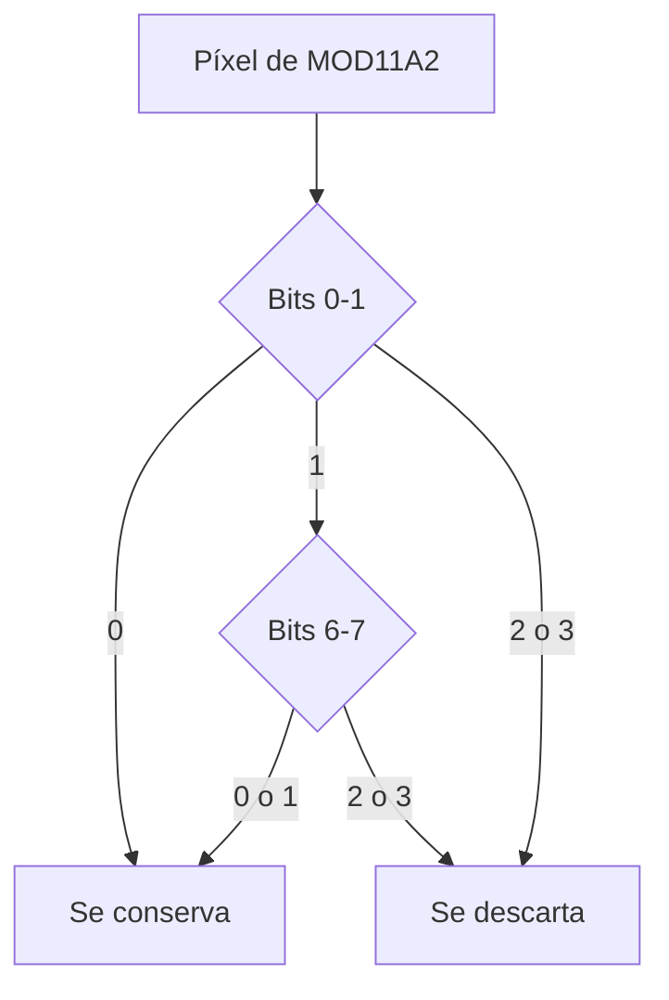

# 4. Datos y APIs

Cada fila dice qué se comprobó el 14 de noviembre de 2026 contra la documentación del proveedor. "Sin verificar" significa que el dato viene de v4 y no se abrió su página.

## 4.1 Inventario

| Pieza | Producto e identificador | Periodo y resolución | Estado |
|---|---|---|---|
| LST Terra, noche y día | `MODIS/061/MOD11A2`, bandas `LST_Night_1km`, `LST_Day_1km`, `QC_Night`, `QC_Day` | 8 días, 1 km, escala 0.02 (K) | Verificado |
| LST Aqua | `MODIS/061/MYD11A2` | 8 días, 1 km | Sin verificar |
| MOD21 noche | `MODIS/061/MOD21A1N`, banda `LST_1KM` | Diario, 1 km, desde 2000-02-24, K con escala ya aplicada | Verificado |
| MOD21 día y MYD21 | `MOD21A1D`, `MYD21A1N`, `MYD21A1D` | Diario, 1 km | Sin verificar |
| NDVI de referencias | `MOD13A2` | 16 días, 1 km | Sin verificar |
| Zoom a 70 m | `ECO_L2T_LSTE` v002, vía AppEEARS | Desde 2018-07-09, 70 m, mosaicos MGRS | Verificado en AppEEARS |
| Zoom en Earth Engine | `NASA/ECOSTRESS/L2T_LSTE/V2` | 70 m | Cobertura dudosa: una versión de la página dice que solo se cargaron mosaicos de Los Ángeles |
| Cotejo externo | `YALE/YCEO/UHI/UHI_yearly_averaged/v4` (media por ciudad) y `UHI_yearly_pixel/v4` (300 m), bandas `Daytime` y `Nighttime` en °C | 2003-2018, CC-BY-4.0 | Verificado |
| Vía A y respaldo de aire | NASA POWER, API mensual: `/api/temporal/monthly/point` | Meteorología MERRA-2 desde 1981; hasta 20 parámetros por punto; JSON o CSV; sin autenticación | Verificado con llamada real desde el navegador (14 nov) |
| Estación de aire | Hermosillo, WMO 76160, en SMN o en Climate Data Online | Por confirmar | Un listado muestra los dos registros de Hermosillo terminando en octubre de 2013 |
| Población | GPW v4.11 | 1 km | Sin verificar |
| Mapa de la Vía B | NASA GIBS, capa `MODIS_Terra_L3_Land_Surface_Temp_8Day_Night` (MOD11A2 v6.1) y paleta `MODIS_Land_Surface_Temp.xml` | 8 días, nivel 7 (unos 1.1 km en Hermosillo) | Verificado en el navegador (15 nov): sin clave, con CORS, 252 colores de 0.6 K cada uno |

## 4.2 NASA POWER (Vía A)

Llamada de prueba, Hermosillo, serie completa:

```text
https://power.larc.nasa.gov/api/temporal/monthly/point?parameters=T2M_MIN,T2M_MAX,TS,PRECTOTCORR&community=AG&longitude=-110.97&latitude=29.07&format=JSON&start=1981&end=2025
```

| Parámetro de la URL | Valor | Nota |
|---|---|---|
| `parameters` | `T2M_MIN,T2M_MAX,TS,PRECTOTCORR` | Hasta 20 por punto. Falta `T2M` para completar las cinco variables |
| `community` | `AG` | |
| `longitude`, `latitude` | `-110.97`, `29.07` | Hermosillo |
| `format` | `JSON` | También admite CSV |
| `start`, `end` | `1981`, `2025` | Años |

Verificado con la primera respuesta real (14 nov, API v2.10.0, desde el navegador):

- [x] Llaves `AAAAMM` con `MM` = 01 a 12, y `AAAA13` para el valor anual.
- [x] Valor de relleno: `header.fill_value` = -999. Hermosillo 1981-2025 no trae ninguno.
- [x] `T2M`, `TS` y `PRECTOTCORR` existen en el servicio mensual.
- [x] El navegador permite la llamada desde otro origen (sin bloqueo CORS).

Qué significa cada valor mensual:

| Parámetro | Valor de cada mes | Llave 13 (anual) | Unidad |
|---|---|---|---|
| `T2M_MIN` | Mínimo del mes (extremo) | Mínimo del año | °C |
| `T2M_MAX` | Máximo del mes (extremo) | Máximo del año | °C |
| `T2M` | Promedio del mes | Promedio del año | °C |
| `TS` | Promedio del mes | Promedio del año | °C |
| `PRECTOTCORR` | Promedio diario del mes | Promedio diario del año | mm/día |

Ejemplo, Hermosillo 1981: `T2M_MIN` de enero = 6.22 °C con `T2M` de enero = 16.94 °C; `T2M_MIN` anual = 3.81 °C, igual al de febrero, el mes más frío.

Desde el workspace de Claude la API no es accesible (red restringida); desde un navegador normal sí.

## Respaldo de la Vía B con NASA GIBS (D18)

La exportación vigente decodifica mosaicos de Terra y Aqua con la paleta de GIBS, cuantizada en pasos de 0.6 K. Usa los criterios de cobertura y número de observaciones de D03 y carece del filtro por bits QC descrito abajo y de MOD21. Las geometrías son esquemáticas hasta resolver D15. Consulta los [metadatos y la completitud](../via-b/datos/reales/metadatos.json) y el [origen de la exportación](../via-b/datos/reales/export/origen.json).

POWER aporta series a escala de celda regional. MOD11A2 v6.1 aporta compuestos de ocho días a 1 km. El producto ECOSTRESS L2T de 70 m aporta observaciones instantáneas para el acercamiento, pendiente para Hermosillo en el conjunto vigente. [NASA POWER](https://power.larc.nasa.gov/docs/faqs/data/) · [NASA MOD11A2](https://ladsweb.modaps.eosdis.nasa.gov/missions-and-measurements/products/MOD11A2) · [NASA/JPL ECOSTRESS](https://ecostress.jpl.nasa.gov/data/atbds-summary-table)

## 4.3 Filtro de calidad de MOD11A2

Se conserva el píxel si:

- los bits 0-1 valen 0 (buena calidad), **o**
- los bits 0-1 valen 1 **y** los bits 6-7 valen 0 o 1 (error medio de LST de 2 K o menos).

El compuesto de 8 días promedia los valores diarios sin filtrar, y su bandera se asigna por mayoría.



## 4.4 Filtro de calidad de MOD21A1N

Usa otros bits. Los bits 0-1 valen:

| Valor | Significado | Acción |
|---|---|---|
| 0 | Bueno | Se conserva |
| 1 | Nominal | Se conserva |
| 2 | Sin dato por nube | Se descarta |
| 3 | Sin dato por otra causa | Se descarta |

MOD21 nocturno es diario. La temporada se promedia desde imágenes diarias; la regla de promedio y el mínimo de noches válidas se fijan en `DECISIONES.md`.

## 4.5 Deriva de órbita

| Satélite | Hecho confirmado |
|---|---|
| Terra | Última maniobra de inclinación el 27 de febrero de 2020; salió de la ventana de 10:30 en abril de 2021 |
| Terra | En sus dos primeros años cruzó el ecuador a las 10:45, no a las 10:30 |
| Aqua | Terminó sus maniobras el 18 de marzo de 2021; deriva desde julio de 2021 |

El periodo 2001-2019 queda limpio en ambos extremos, salvo el cruce a las 10:45 de los dos primeros años de Terra. Por eso existe la variante `sin_2001_2002`.

## 4.6 Yale no es un sensor independiente

El producto de Yale se construyó con los mismos productos MODIS de 8 días de Terra y Aqua. Coteja el método, no el instrumento, y así se dice. Su banda `Daytime` sirve además como segundo cotejo del oasis: el signo de su valor diurno para Hermosillo se pone junto a las barras de 10:30 y 13:30.

## 4.7 Metadatos y revisión de cada conjunto

Cada carpeta de datos lleva un `metadatos.json` con el mismo esquema: `fuente`, `productos`, `version`, `fechas` (ISO 8601) y `completitud`, que cuenta años y polígono-años válidos y descartados, con el motivo de cada descarte (`sin_dato`, `cobertura_menor_al_minimo` u `observaciones_insuficientes`, según D03).

| Carpeta | Quién lo escribe | Qué dice |
|---|---|---|
| `via-b/datos/reales/` | `procesar.py`, en cada corrida | Fuente del export (GIBS por `export/origen.json`, o Earth Engine), productos MOD11 o MOD21 que llegaron y los que faltan, años completos, descartes por producto y años válidos por sector |
| `via-b/datos/prueba/` | `via-b/procesamiento/metadatos.py` | Que los datos son inventados, la semilla y los polígonos esquemáticos |
| `via-a/datos/` | `via-b/procesamiento/metadatos.py` | Versión de la API de POWER, punto, periodo y meses con valor de relleno por parámetro. El JSON de POWER no trae fecha de descarga: se toma la del último commit |

Antes de procesar polígonos nuevos (D15) se corre `via-b/procesamiento/revisar_poligonos.py`: identificadores, tipos, `RA` y `RB`, geometría válida, 9 km² por sector y traslapes. `resumen.json` trae además, por sector, el ruido de la serie y la pendiente mínima detectable (sección 5.6 de [05-MODELOS.md](05-MODELOS.md)).

## 4.8 Fuentes

- NASA POWER, API mensual y resumen de servicios
- Earth Engine: MOD11A2 v6.1
- Earth Engine: MOD21A1N v6.1
- Earth Engine: islas de calor de Yale, v4
- Earth Engine: ECOSTRESS L2T LSTE v2
- Earthdata: ECO_L2T_LSTE v002 y AppEEARS 3.24
- Terra: inicio de la deriva
- NSIDC: cambios de órbita de Terra y Aqua
- López González y otros (2021), Frontera Norte
- Berkeley Earth: estaciones de Hermosillo
- Sonora Calor, Plan de equipo v4 (PDF del 10 de noviembre) y texto del reto pegado por Mario
