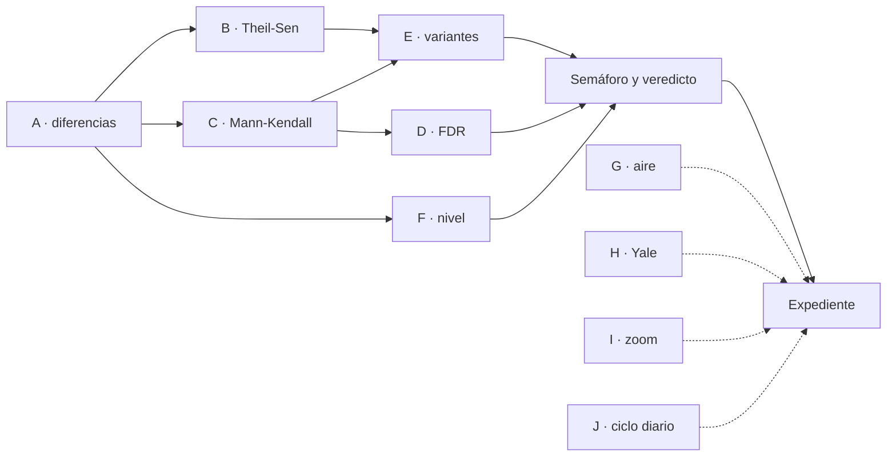

# 5. Modelos matemáticos

Todo el proyecto usa una sola función: recibe una serie anual y devuelve pendiente, intervalo y valor p. La Vía B la corre en Python sobre diferencias sector − desierto; la Vía A la repite en JavaScript sobre una variable de POWER.

## 5.1 Resumen de modelos

| Modelo | Nombre | Qué hace | Da valor p |
|---|---|---|---|
| A | Serie de diferencias | Sector menos desierto, por año | No |
| B | Theil-Sen | Pendiente por década e intervalo del 95 % | No |
| C | Mann-Kendall | Significancia de la tendencia | Sí |
| D | FDR | Ajuste por probar varios sectores | Sí |
| E | Variantes | Repite el cálculo cambiando un supuesto | Sí |
| F | Nivel | Media de la serie de diferencias 2001-2019, como rango MOD11-MOD21 | No |
| G | Aire | Correlación entre LST nocturno anual y temperatura mínima de estación o `T2M_MIN` de POWER | No |
| H | Yale | Diferencia nocturna de toda la mancha, 2003-2018, junto a la banda `Nighttime` de Yale | No |
| I | Zoom | Mediana por píxel de escenas nocturnas despejadas de ECOSTRESS | No |
| J | Ciclo diario | Media 2003-2019 de la diferencia sector − referencia A en 10:30, 13:30, 22:30 y 1:30 | No |



## 5.2 Modelo A: serie de diferencias

Para cada año válido en ambos polígonos:

$$\Delta_{s,t} = \overline{LST}_{s,t} - \overline{LST}_{ref,t}$$

## 5.3 Modelo B: pendiente Theil-Sen

Mediana de las pendientes entre todos los pares de años, multiplicada por 10 para dar °C por década. Intervalo del 95 % con `scipy.stats.theilslopes(y, x, alpha=0.95)`.

$$\hat\beta = \operatorname{mediana}_{i<j}\left(\frac{\Delta_j - \Delta_i}{t_j - t_i}\right)$$

## 5.4 Modelo C: Mann-Kendall

Cuenta cuántos pares suben menos cuántos bajan. Se corre la versión original y la de Hamed-Rao con `pymannkendall`, y se reporta el p mayor.

$$S = \sum_{i<j} \operatorname{sgn}(\Delta_j - \Delta_i)$$

$$\operatorname{Var}(S) = \frac{n(n-1)(2n+5)}{18}$$

$$Z = \frac{S - \operatorname{sgn}(S)}{\sqrt{\operatorname{Var}(S)}}$$

## 5.5 Modelo D: FDR

Benjamini-Hochberg sobre un máximo de 6 valores p, uno por sector:

```python
multipletests(p, alpha=0.05, method="fdr_bh")
```

## 5.6 Qué tan fuerte debe ser la señal

Calculado con la fórmula de arriba, sin empates ni corrección por autocorrelación. S es la cuenta de pares que suben menos los que bajan.

| Años | Uso | Pares | S mínimo para p < 0.05 | S mínimo si solo un sector de 6 pasa FDR |
|---|---|---|---|---|
| 17 | Variante sin 2001-2002 | 136 | 50 | 66 |
| 19 | Primario 2001-2019 | 171 | 59 | 77 |
| 25 | Con deriva, 2001-2025 | 300 | 86 | 114 |
| 45 | Vía A, 1981-2025 | 990 | 202 | 272 |

Simulación: 20,000 series de 19 años por celda, ruido gaussiano sin autocorrelación. Cada celda es el porcentaje de veces que Mann-Kendall da p < 0.05, según la tendencia real (columnas, en °C por década).

| Ruido entre años | 0.1 | 0.2 | 0.3 | 0.5 | 0.8 |
|---|---|---|---|---|---|
| 0.15 °C | 26 % | 79 % | 98 % | 100 % | 100 % |
| 0.25 °C | 12 % | 37 % | 70 % | 99 % | 100 % |
| 0.40 °C | 7 % | 17 % | 34 % | 73 % | 99 % |

Con el umbral más estricto de FDR, una tendencia de 0.3 °C por década con ruido de 0.25 °C se detecta el 39 % de las veces. **Un sector en gris puede tener tendencia real: 19 años no alcanzan para pendientes chicas.** El ruido real se conoce al tener la serie; esta tabla se lee con ese número.

## 5.7 Modelo E: variantes

Se conservan las cuatro de v4 y se agrega una. La curva de variantes queda con cinco.

| Variante | Qué cambia | Qué descarta | Origen |
|---|---|---|---|
| `con_deriva` | Definido en v4 | Definido en v4 | v4 |
| `aqua` | Definido en v4 | Definido en v4 | v4 |
| `ref_b` | Definido en v4 | Definido en v4 | v4 |
| `mod21` | Definido en v4 | Definido en v4 | v4 |
| `sin_2001_2002` | Terra 2003-2019 | Que la tendencia venga del cambio de hora de cruce de 10:45 a 10:30 | v5 |

`sin_2001_2002` empieza en 2003, igual que Aqua y Yale. `DECISIONES.md` debe decir si cuenta para el semáforo antes de calcular.

Las variantes no son pruebas independientes: repiten el cálculo sobre datos que se traslapan.

## 5.8 Modelos descriptivos, sin valor p

- **Nivel (F):** media de la serie de diferencias 2001-2019, como rango MOD11-MOD21.
- **Aire (G):** correlación entre LST nocturno anual y temperatura mínima de estación o `T2M_MIN` de POWER.
- **Yale (H):** la diferencia nocturna de toda la mancha, 2003-2018, junto a la banda `Nighttime` de Yale.
- **Zoom (I):** mediana por píxel de escenas nocturnas despejadas de ECOSTRESS.
- **Ciclo diario (J):** media 2003-2019 de la diferencia sector − referencia A en 10:30, 13:30, 22:30 y 1:30. Bajo cero es oasis; sobre cero es isla de calor.

Ajustes al Modelo J:

- En los pasos de Terra (10:30 y 22:30) se reporta rango MOD11-MOD21.
- En los pasos de Aqua (13:30 y 1:30) se reporta solo MOD11, salvo que Navarrete confirme y exporte MYD21. Se decide antes del commit.

## 5.9 Función de referencia

Vive en [`compartido/tendencia.py`](../compartido/tendencia.py). Corre con scipy, pymannkendall y statsmodels. No contiene resultados reales.

```python
import numpy as np
from scipy.stats import theilslopes
import pymannkendall as mk
from statsmodels.stats.multitest import multipletests


def tendencia(anios, delta, min_anios=15):
    """min_anios=15 es un marcador: el mínimo real se fija en docs/DECISIONES.md."""
    a = np.asarray(anios, float); d = np.asarray(delta, float)
    ok = ~np.isnan(d); a, d = a[ok], d[ok]
    n = len(d)
    if n < min_anios:
        return dict(n_anios=n, pendiente_c_decada=np.nan, ic95_inf=np.nan,
                    ic95_sup=np.nan, p_mk=np.nan, p_hamed_rao=np.nan, p=np.nan,
                    hamed_rao_valido=False)
    pend, _, lo, hi = theilslopes(d, a, alpha=0.95)
    p_mk = mk.original_test(d).p
    with np.errstate(invalid="ignore"):
        p_hr = mk.hamed_rao_modification_test(d).p
    # D13: Hamed-Rao puede dar varianza negativa y p = NaN; max(p_mk, nan) lo ocultaría
    hr_ok = bool(np.isfinite(p_hr))
    return dict(n_anios=n, pendiente_c_decada=pend*10, ic95_inf=lo*10,
                ic95_sup=hi*10, p_mk=p_mk, p_hamed_rao=p_hr,
                p=max(p_mk, p_hr) if hr_ok else p_mk, hamed_rao_valido=hr_ok)


def ajustar_fdr(ps):
    return multipletests(ps, alpha=0.05, method="fdr_bh")[1]
```

`min_anios=15` es un marcador: el mínimo real lo fija Navarrete en `DECISIONES.md` (D08).

Si Hamed-Rao no se puede calcular (varianza negativa con tendencias fuertes), `p` es el de Mann-Kendall original y `hamed_rao_valido` vale `False` (D13).

## 5.10 Cálculo en la Vía A

Serie anual de la variable, 1981-2025 (45 años). Theil-Sen con intervalo del 95 % y Mann-Kendall, escritos en JavaScript. El valor p se muestra sin ajuste y con la etiqueta "exploratorio", porque el usuario elige qué probar.

Prueba de igualdad: la misma serie debe dar la misma pendiente en JavaScript y en la función de Python, a tres decimales.
