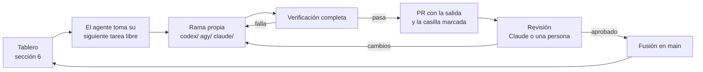

# 6. Plan de tres agentes

Escrito el 15 de noviembre de 2026. Reglas de trabajo en [AGENTS.md](../AGENTS.md).

## 1. Dónde está el proyecto hoy

Auditoría del repositorio al 15 de noviembre:

| Tema | Estado |
|---|---|
| Historial | Limpio. Seis PR fusionados, todos de la Vía B. `main` es la única rama viva; quedan siete ramas remotas `via-b/*` ya fusionadas que se pueden borrar |
| Pruebas | Pasan todas: 119 casos de estadística (JavaScript igual a Python, diferencia máxima 8e-8), procesamiento de punta a punta y 7 pruebas de aceptación de la Vía B |
| Vía A | Funciona con datos reales de NASA POWER en vivo. El rediseño con globo 3D está hecho y probado en escritorio y celular, pero **sin confirmar en git** |
| Vía B | Interfaz completa (expediente, semáforo D16, variantes, ciclo diario, zoom), pero **todo con datos inventados** |
| Decisiones | D15 (polígonos reales) sigue abierta. Cuatro comprobaciones de `DECISIONES.md` siguen en blanco: escenas de ECOSTRESS, noches válidas de `MOD21A1N`, MYD21 y años de la estación |
| Publicación | Repositorio privado, sin sitio publicado y sin integración continua |
| Automatización | No había reglas para agentes ni un comando único de verificación |

## 2. Qué falta para que sea una solución real

Hoy SunCity es una demostración honesta. Para que le sirva a una persona de Hermosillo faltan cuatro cosas, en este orden:

1. **Verdad.** La Vía B necesita resultados observados. Sin polígonos reales (D15) y sin la exportación de Earth Engine no hay nada que mostrarle a nadie. Esto depende de personas: ningún agente tiene la cuenta.
2. **Acceso.** Una dirección pública que abra en un celular con datos móviles, sin instalar nada.
3. **Utilidad.** Que alguien encuentre su zona sin saber qué es un sector, entienda el resultado en una frase y pueda llevarse una hoja impresa a una junta de vecinos o a planeación urbana.
4. **Validación.** Probarlo con vecinos y con quien planea la ciudad, y comparar con temperatura del aire medida. Solo después de eso se revisa la lista de [lo que no se afirma](01-PLAN.md#7-lo-que-no-se-afirma).

El proyecto no mide salud ni temperatura del aire. La frase que los datos sostienen sigue siendo: muestra en qué sectores la noche se calienta más rápido, con cuánta certeza y cuánta gente vive ahí. El plan hace esa frase verdadera y fácil de usar; no la agranda.

## 3. Los tres carriles

| Carril | Agente | Por qué ese agente | Dueño humano |
|---|---|---|---|
| Datos y verificación | Codex | Trabajo de terminal guiado por pruebas: Python, validadores, integración continua | Navarrete |
| Interfaz de Hermosillo | Antigravity | Trae navegador propio para comprobar la interfaz y dejar evidencia | Mario |
| Vía A, diseño e integración | Claude | Ya tiene el contexto del rediseño; revisa los PR de los otros dos | Navarrete |

Los archivos de cada carril están en [AGENTS.md](../AGENTS.md). Ningún agente toca archivos de otro carril, así que pueden trabajar al mismo tiempo sin conflictos.

**Supuesto por confirmar:** el carril de Antigravity cae sobre los archivos de Mario. Se asume que Mario lo dirige o lo aprueba; si no, ese carril se queda en manos de Mario y sus tareas pasan a ser suyas.

## 4. Cómo trabajan solos



- El tablero es la única cola de trabajo. Una tarea está libre cuando su casilla está vacía y sus dependencias están marcadas.
- Cada tarea trae archivos, dependencias y un criterio de aceptación que se comprueba con un comando o con una revisión en navegador.
- Un agente que se topa con una tarea **H** se detiene, deja la pregunta escrita y pasa a la siguiente tarea libre.
- Nadie fusiona su propio PR.

### Mensaje de arranque

Pegar tal cual en cada herramienta, cambiando solo el carril:

```text
Trabajas en el repositorio SunCity. Lee AGENTS.md y docs/06-PLAN-AGENTES.md completos.
Tu carril es <Codex | Antigravity | Claude>. Toma la primera tarea libre de tu carril,
créale su rama, cumple su criterio de aceptación, corre la verificación y abre el PR
marcando la casilla. Después sigue con la siguiente tarea libre. Detente y pregunta
solo en los casos que lista AGENTS.md.
```

## 5. Fases

| Fase | Cuándo | Meta | Sale cuando |
|---|---|---|---|
| 0. Entrega | Hoy, antes de las 20:00 | Enviar sin romper nada | El envío está hecho |
| 1. Base automática | Días 1 a 3 | Un comando verifica todo y corre en cada PR; un solo sistema de diseño | `python verificar.py` pasa en `main` y en la integración continua |
| 2. Datos reales | Semanas 1 y 2 | La Vía B muestra resultados observados | `aceptacion.py` pasa sobre `datos/reales/` y desaparece el aviso de datos inventados |
| 3. Útil para personas | Semanas 2 y 3 | Encontrar mi zona, entenderla y llevármela impresa, desde un celular | Sitio público; una persona ajena llega de su ubicación al veredicto sin ayuda |
| 4. Validación | Semana 4 | Saber si de verdad sirve | Cinco vecinos y una persona de planeación lo usaron y sus hallazgos están registrados |

En la fase 0 no entra ninguna función nueva: el plan de fases congela funciones a las 15:00.

## 6. Tablero

### Personas (H)

- [x] **H1** Decidir si el rediseño de la Vía A entra antes del envío o después. Decidido el 15 de noviembre: entra antes del envío.
- [ ] **H2** Cerrar D15: polígonos reales de sectores y las dos referencias de desierto. Cada sector de 9 km² o más; referencias con NDVI menor que 0.2.
- [ ] **H3** Correr `exportar_ee.js` en Earth Engine y bajar los tres CSV a `via-b/datos/reales/export/`. Depende de H2 y X3.
- [ ] **H4** Pedir ECOSTRESS en AppEEARS para el sector prioritario (D10).
- [ ] **H5** Decidir cómo se publica: repositorio público con GitHub Pages u otro alojamiento.
- [ ] **H6** Envío del hackathon: video, pitch y formulario.
- [ ] **H7** Sesiones con cinco vecinos y una persona de planeación urbana. Depende de la fase 3.

### Codex: datos y verificación (X)

- [ ] **X1** `verificar.py` en la raíz: corre en orden la generación de casos, la prueba de estadística, la prueba de procesamiento, el validador y las pruebas de aceptación; además busca en `via-a/` y `via-b/` los textos prohibidos por la sección 7 del plan. *Acepta:* sale con código 0 en `main` y con código 1 si se rompe cualquiera de las pruebas.
- [ ] **X2** Integración continua: `.github/workflows/verificar.yml` corre `verificar.py` en cada PR con Python y Node. *Depende:* X1. *Acepta:* un PR de prueba con un fallo a propósito sale en rojo.
- [ ] **X3** `via-b/procesamiento/revisar_poligonos.py`: revisa un `sectores.geojson` antes de mandarlo a Earth Engine: `id` únicos, `tipo` válido, `RA` y `RB` presentes, área de cada sector de 9 km² o más, sin traslapes. *Acepta:* pasa con los polígonos de prueba y falla con un archivo de ejemplo roto incluido en la prueba.
- [ ] **X4** Primera corrida real: `procesar.py` sobre la exportación, `validar.py` y `aceptacion.py` sobre `via-b/datos/reales/`. *Depende:* H3. *Acepta:* las tres pasan; el PR lista los avisos de `resumen.json` y los números que faltan en la tabla de hechos de `DECISIONES.md` para que Claude los registre.
- [ ] **X5** Potencia por sector: `procesar.py` escribe en `resumen.json` la pendiente mínima detectable de cada sector con su ruido real, según [05-MODELOS.md](05-MODELOS.md). *Depende:* X4. *Acepta:* prueba unitaria con una serie sintética de ruido conocido.
- [ ] **X6** Publicación: flujo de GitHub Pages que publica el sitio estático desde `main`. *Depende:* H5, X2, C3. *Acepta:* la dirección pública abre las dos vías.

### Antigravity: interfaz de Hermosillo (G)

- [ ] **G1** La Vía B usa `compartido/tokens.css`: colores, tipografía, radios y la misma jerarquía de botones que la Vía A, sin cambiar identificadores ni estructura. *Depende:* C2. *Acepta:* `aceptacion.py` pasa; capturas a 375 y 1366 px en el PR.
- [ ] **G2** "Usar mi ubicación": un botón ubica el punto de la persona, busca el polígono que lo contiene y abre ese expediente; si queda fuera de todos, lo dice. La ubicación no sale del navegador. *Acepta:* probado con una coordenada dentro de un sector y otra fuera.
- [ ] **G3** Lectura en lenguaje llano: cada expediente abre con dos o tres frases generadas del resultado (color, cuánto por década, certeza, población) que explican qué significa gris. *Acepta:* la prueba de textos de `aceptacion.py` sigue pasando; revisado con un sector rojo, uno azul, uno gris y uno sin cálculo.
- [ ] **G4** Ficha imprimible: hoja de estilos de impresión que deja el expediente en una página con fuente, fecha y la advertencia de alcance. *Acepta:* PDF de una página adjunto en el PR.
- [ ] **G5** Datos reales en pantalla: el aviso "Datos de prueba inventados" solo aparece cuando `RUTA_DATOS` apunta a `datos/prueba/`. *Depende:* X4. *Acepta:* probado con las dos rutas.
- [ ] **G6** Revisión de accesibilidad: teclado de principio a fin, contraste, foco y hoja inferior en celular. *Depende:* G1. *Acepta:* lista de hallazgos con su arreglo en el PR.

### Claude: Vía A, diseño e integración (C)

- [x] **C1** Confirmar el rediseño de la Vía A (globo 3D, paleta, jerarquía de botones) en una rama y abrir su PR. *Depende:* H1. *Acepta:* verificación completa y prueba en navegador a 375 y 1366 px.
- [ ] **C2** Sacar los tokens de diseño a `compartido/tokens.css` y hacer que la Vía A los use. *Depende:* C1. *Acepta:* la Vía A se ve igual antes y después.
- [ ] **C3** Portada en la raíz: una página que explica en tres frases qué es, enlaza las dos vías y dice lo que la herramienta no puede ver. `servir.py` anuncia las dos direcciones. *Acepta:* abre desde `/`.
- [ ] **C4** Vía A sin red: con el mapa y POWER caídos, el flujo completo funciona con los respaldos guardados y lo dice en pantalla. *Acepta:* probado con la red del navegador bloqueada.
- [ ] **C5** "Usar mi ubicación" en la Vía A, con el mismo trato de privacidad que G2. *Acepta:* probado aceptando y negando el permiso.
- [ ] **C6** Documentación al día: fila nueva en `DECISIONES.md` por el cambio de Leaflet a MapLibre, estado del `README.md`, hechos reales cuando llegue X4. *Acepta:* ningún documento contradice al código.
- [ ] **C7** Revisión continua de los PR de Codex y Antigravity contra `AGENTS.md`, con atención a los contratos y a los textos prohibidos.

## 7. Qué puede salir mal

| Riesgo | Señal | Respuesta |
|---|---|---|
| Los datos reales no llegan | H2 o H3 sin marcar al final de la semana 1 | Codex y Antigravity siguen con lo que no depende de X4; la fase 3 se publica con el aviso de datos inventados visible |
| Dos agentes chocan en un archivo | Conflicto al fusionar | Gana el dueño del carril; el otro abre un issue |
| Un agente afirma de más | Falla la búsqueda de textos de `verificar.py` | El PR no se fusiona |
| Las pendientes reales salen todas grises | Resultado de X4 | Se muestra así; X5 explica cuánta pendiente se podía detectar. No se cambia una regla después de ver el resultado |
| La interfaz cambia y Mario no está de acuerdo | Comentarios en el PR | Mario decide: su carril, su palabra |
