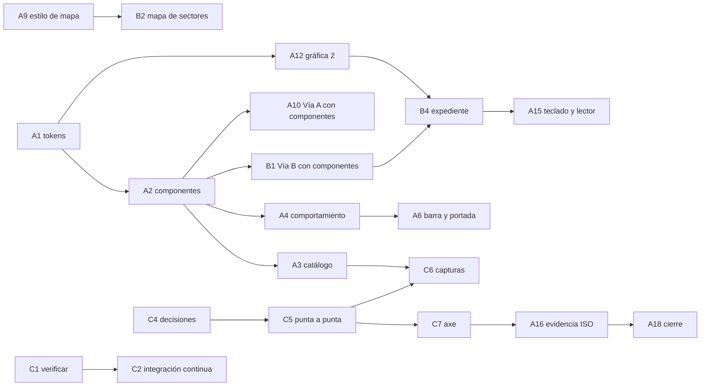

# 7. Plan de cierre: SunCity 1.0

Escrito el 15 de noviembre de 2026. Sustituye al tablero de [06-PLAN-AGENTES.md](06-PLAN-AGENTES.md); las reglas de trabajo siguen en [AGENTS.md](../AGENTS.md).

Meta: pasar de dos demostraciones sueltas a **una plataforma terminada**, con un solo sistema de diseño, todos sus estados resueltos y calidad comprobable contra normas ISO.

## 1. Qué significa "terminado"

La versión 1.0 existe cuando se cumplen las diez condiciones. Cada una se comprueba con un comando o con una evidencia guardada en el repositorio.

| # | Condición | Cómo se comprueba |
|---|---|---|
| 1 | Las dos vías usan los mismos tokens y componentes; no queda un color, radio o tamaño suelto | `verificar.py` falla si encuentra un valor hexadecimal fuera de `compartido/tokens.css` |
| 2 | Cada componente tiene todos sus estados dibujados | Catálogo vivo en `compartido/catalogo.html` |
| 3 | Cada pantalla resuelve carga, vacío, error, sin red y datos parciales | Pruebas de punta a punta, una por estado |
| 4 | Accesibilidad WCAG 2.2 nivel AA | axe sin infracciones; recorrido completo solo con teclado |
| 5 | Funciona en 375, 768 y 1366 px, en Chromium, Firefox y WebKit | Matriz de pruebas de punta a punta |
| 6 | Rápida en un celular con datos móviles | Lighthouse: rendimiento 90 o más, LCP menor que 2.5 s, CLS menor que 0.1 |
| 7 | No depende de terceros para abrir | Con la red externa bloqueada, la plataforma carga y dice qué falta |
| 8 | Segura como sitio estático | Política de seguridad de contenido activa, sin `innerHTML` con datos externos |
| 9 | Publicada y versionada | Dirección pública, etiqueta `v1.0.0`, `CHANGELOG.md` |
| 10 | La Vía B muestra datos observados | `aceptacion.py` pasa sobre `datos/reales/`. Depende de cerrar D15 |

## 2. Normas y evidencia

El proyecto **se alinea** con estas normas y guarda la evidencia. Una certificación formal exige una auditoría externa; este plan deja listo lo que esa auditoría pediría.

| Norma | Qué exige aquí | Evidencia |
|---|---|---|
| ISO 9241-110 (principios de interacción) | Los siete principios de la sección 2.1 | Lista de comprobación por pantalla en `docs/calidad/9241-110.md` |
| ISO 9241-11 (usabilidad) | Eficacia, eficiencia y satisfacción medidas | Del lugar al veredicto en 60 s o menos; 9 de cada 10 tareas terminadas |
| ISO 9241-210 (diseño centrado en las personas) | Diseñar, evaluar y corregir en ciclos | Hallazgos y correcciones registrados por versión |
| ISO 9241-125 (presentación visual) | Jerarquía, agrupación, legibilidad y consistencia | Catálogo y revisión de cada pantalla |
| ISO/IEC 40500 (WCAG) | Se apunta a WCAG 2.2 AA, que la contiene | Informe de axe y recorrido con teclado y lector de pantalla |
| ISO/IEC 25010 (calidad del producto) | Las características de la sección 2.2 | `docs/calidad/25010.md` con una fila por característica |
| ISO/IEC 25012 (calidad de datos) | Origen, fecha, versión y completitud de cada dato | `metadatos.json` junto a cada conjunto de datos, visible en pantalla |
| ISO 8601 | Fechas sin ambigüedad en datos y nombres de archivo | Validador |

### 2.1 Los siete principios, en concreto

| Principio | En SunCity |
|---|---|
| Adecuación a la tarea | Tres preguntas y un veredicto; nada que no sirva para llegar ahí |
| Autodescripción | Cada término tiene definición; cada dato dice su fuente, su fecha y su límite |
| Conformidad con las expectativas | Los mismos componentes se ven y se comportan igual en las dos vías |
| Facilidad de aprendizaje | Ejemplos listos; la primera visita llega a un resultado sin leer ayuda |
| Controlabilidad | Todo se puede deshacer, cancelar y compartir por enlace; el botón Atrás funciona |
| Robustez ante errores | Los errores dicen qué pasó y qué hacer; nunca un mensaje técnico ni una pantalla en blanco |
| Capacidad de atraer | El globo, el movimiento medido y un resultado que se entiende de un vistazo |

### 2.2 Calidad del producto

| Característica | Umbral |
|---|---|
| Adecuación funcional | Todas las pruebas de aceptación pasan; JavaScript igual a Python a tres decimales |
| Eficiencia de desempeño | Menos de 300 kB de JavaScript propio y de terceros en la primera carga de cada vía, sin contar el mapa |
| Compatibilidad | Las dos últimas versiones de Chrome, Firefox, Safari y Edge |
| Capacidad de interacción | Secciones 2 y 2.1 |
| Fiabilidad | Sin red externa la plataforma abre; un CSV roto no tumba la página |
| Seguridad | Sin secretos, sin código en línea, sin HTML construido con datos externos |
| Mantenibilidad | Un solo archivo de tokens; componentes documentados; `verificar.py` en cada PR |
| Flexibilidad | Cambiar de ciudad es cambiar una carpeta de datos y una configuración |
| Seguridad de uso | Ningún texto afirma lo que prohíbe la sección 7 de [01-PLAN.md](01-PLAN.md) |

## 3. Tres personas

| | Persona A | Persona B | Persona C |
|---|---|---|---|
| Papel | Sistema de diseño y Vía A | Vía B: Hermosillo | Calidad, datos y publicación |
| Agente de apoyo | Claude | Antigravity | Codex |
| Es dueña de | `compartido/tokens.css`, `compartido/componentes.*`, `compartido/catalogo.html`, `compartido/iconos.svg`, `compartido/serie-anual.js`, `compartido/mapa-estilo.js`, `via-a/**`, `index.html`, `metodo/**`, `docs/**` | `via-b/*.html`, `via-b/*.css`, `via-b/*.js` | `verificar.py`, `pruebas/**`, `.github/**`, `compartido/vendor/**`, `via-b/procesamiento/**`, `via-b/datos/**`, `via-b/pruebas/**`, `via-a/pruebas/**`, `compartido/tendencia.py` |
| Revisa los PR de | B y C | A | A y B, solo la parte de pruebas |

Regla de oro: **A define los componentes, B los usa, C comprueba que nadie se salga.** Si B necesita un componente que no existe, lo pide a A; no lo crea en `via-b/`.

## 4. Sistema de diseño

### 4.1 Tokens (`compartido/tokens.css`)

Salen de `via-a/css/estilos.css`, que ya los tiene. Tres capas:

| Capa | Ejemplos | Regla |
|---|---|---|
| Primitivos | `--noche-900`, `--arena-200`, `--verde-600` | Nunca se usan directo en un componente |
| Semánticos | `--superficie`, `--texto`, `--texto-2`, `--linea`, `--borde`, `--accion`, `--foco`, `--dato`, `--estado-sube`, `--estado-baja`, `--estado-neutro`, `--exito`, `--aviso`, `--error` | Son los únicos que usan los componentes |
| De escala | Tipografía `--t-xs` a `--t-3xl`; espacio `--e-1` a `--e-8` (base 4 px); radios 6, 10, 16 y 999 px; sombras `--sombra-1` y `--sombra-2`; capas `--z-barra`, `--z-hoja`, `--z-dialogo`, `--z-aviso`; movimiento `--dur-rapida`, `--dur`, `--curva` | Ningún valor fuera de la escala |

Dos temas con los mismos nombres semánticos: `tema-papel` (claro, el de lectura) y `tema-noche` (oscuro, el del escenario del mapa). Un componente no sabe en qué tema está.

Colores de gráfica: `--graf-serie`, `--graf-tendencia`, `--graf-banda`, `--graf-rejilla`, `--graf-eje`, y la escala del semáforo. Ninguna gráfica lleva un color escrito a mano.

### 4.2 Componentes (`compartido/componentes.css` y `.js`, prefijo `sc-`)

Estados obligatorios de todo componente interactivo: reposo, cursor encima, foco, presionado, deshabilitado y, si aplica, cargando, seleccionado y con error.

| Componente | Variantes | Notas de especificación |
|---|---|---|
| `sc-boton` | primario, secundario, texto, solo ícono; tamaños normal y compacto | Un primario por vista. Cargando conserva el ancho y el color y lleva `aria-busy`. Solo ícono exige `aria-label` |
| `sc-chip` | de acción (`aria-pressed`) y de opción (radio) | Altura 40 px con ratón y 44 px con dedo |
| `sc-segmento` | tira de opciones excluyentes (meses, variantes) | Navegación con flechas |
| `sc-campo` | texto, número, selector | Etiqueta siempre visible, ayuda debajo, error debajo enlazado con `aria-describedby` |
| `sc-insignia` | sube, baja, neutro, sin cálculo, significativo, exploratorio | Siempre ícono o forma más texto; el color nunca va solo |
| `sc-aviso` | información, éxito, advertencia, error, datos de prueba | Fijo junto a lo que afecta; el de error lleva `role="alert"` y una acción |
| `sc-toast` | éxito, deshacer, error | Región `aria-live`; el de error no se cierra solo |
| `sc-cifra` | etiqueta más valor en fuente mono | Para pendiente, intervalo, p y años |
| `sc-tarjeta` | contenedor con borde, sin sombra | Solo para contenido heterogéneo; una lista de iguales es una tabla |
| `sc-tabla` | ordenable; se vuelve tarjetas en celular | Encabezados `th` con `scope`; números a la derecha en mono |
| `sc-hoja` | panel lateral en escritorio, hoja inferior en celular | Atrapa el foco, cierra con Escape y devuelve el foco a quien la abrió |
| `sc-dialogo` | confirmación | Título con verbo y objeto; el foco inicial va en cancelar |
| `sc-esqueleto` | línea, bloque, gráfica | Tiene la forma de lo que viene; nunca un giro suelto para una sección |
| `sc-vacio` | con y sin acción | Dice qué falta y qué hacer |
| `sc-leyenda` | de mapa y de gráfica | Misma muestra que el dibujo: trazo, relleno y patrón |
| `sc-barra` | barra de la plataforma | Marca, navegación entre vías, enlace a Método. Enlace "Saltar al contenido" primero |
| `sc-pie` | pie de la plataforma | Fuentes, versión de los datos, versión del software |
| `sc-migas` | ruta | Solo donde hay tres niveles o más |
| Gráficas | serie anual, ciclo diario, curva de variantes, zoom | Ejes y rejilla iguales; punto enfocable con teclado; valor al pasar; botón "Ver datos en tabla" |
| Mapa | globo (Vía A) y plano de sectores (Vía B) | El mismo estilo desde `compartido/mapa-estilo.js`; siempre con una alternativa sin mapa |

### 4.3 Reglas visuales

- Rejilla de 4 px; anchos de lectura de 62 caracteres como máximo.
- Tres familias: Fraunces en titulares, Hanken Grotesk en texto, IBM Plex Mono en cifras. Servidas desde el propio sitio.
- Plano por defecto: separan las líneas. La sombra queda para lo que flota: hoja, diálogo y toast.
- Movimiento entre 150 y 250 ms, solo en opacidad y transformación; se apaga con `prefers-reduced-motion`.
- Un solo juego de íconos, de trazo de 2 px, en `compartido/iconos.svg`.
- Textos: tú, sin signos de exclamación; botones con verbo y objeto; los errores dicen qué pasó y qué hacer.

## 5. Estructura de la plataforma

| Ruta | Qué es | Dueña |
|---|---|---|
| `/` | Portada: qué es en tres frases, entrada a las dos vías y lo que la herramienta no puede ver | A |
| `/via-a/` | Región: cualquier punto del planeta | A |
| `/via-b/` | Hermosillo: mapa, tabla de sectores y expediente | B |
| `/metodo/` | Método, glosario, fuentes, límites y versión de los datos | A |
| `/404.html` | Página no encontrada, con salida a la portada | A |

La barra y el pie son elementos propios (`<sc-barra>`, `<sc-pie>`) definidos en `compartido/componentes.js`, sin dependencias. Sin JavaScript queda un enlace simple a la portada.

## 6. Tablero

Tamaño: **C** medio día, **M** uno o dos días, **G** tres o cuatro días. Una tarea está libre cuando sus dependencias están marcadas.

### Fase 1. Cimientos

- [x] **A1 · M** `compartido/tokens.css` con las tres capas y los dos temas; la Vía A lo consume. *Acepta:* la Vía A se ve igual, con diferencia de captura menor que 0.1 %. *Hecho en PR #9:* el globo se anima y la captura no es repetible, así que se compararon los estilos calculados de 331 elementos a 1366 y 375 px, sin diferencias.
- [x] **A2 · G** `compartido/componentes.css` con todos los componentes y estados de 4.2. *Depende:* A1.
- [x] **A3 · M** `compartido/catalogo.html`: cada componente, cada estado, en los dos temas, con el código que lo produce. *Depende:* A2. *Acepta:* es la referencia que usan B y las pruebas de C.
- [x] **A4 · M** `compartido/componentes.js`: hoja, diálogo, toast, segmento con flechas, barra y pie. *Depende:* A2. *Acepta:* cada uno se maneja completo con teclado.
- [x] **A5 · C** `compartido/iconos.svg` y su uso con `<use>`. *Acepta:* no queda un ícono dibujado en línea.
- [ ] **C1 · M** `verificar.py`: todas las pruebas actuales, más la búsqueda de textos prohibidos y de colores fuera de los tokens. *Acepta:* código 0 en `main`; código 1 con cualquier fallo.
- [ ] **C2 · C** Integración continua que corre `verificar.py` en cada PR. *Depende:* C1.
- [ ] **C3 · M** Terceros servidos desde el sitio: MapLibre y las tres fuentes en `compartido/vendor/`, con su archivo de licencias. *Acepta:* cero peticiones a `unpkg.com` y a `fonts.googleapis.com`.
- [ ] **C4 · C** Registrar en `DECISIONES.md` las decisiones técnicas nuevas: herramientas de prueba solo para desarrollo, terceros servidos localmente y MapLibre en la Vía B.

### Fase 2. Plataforma

- [x] **A6 · M** Barra y pie en todas las rutas; portada en `/`. *Depende:* A4. *Nota:* la Vía B pone `<sc-barra raiz="../" actual="via-b">` y `<sc-pie>` en B1, porque `via-b/` es de su carril.
- [x] **A7 · M** `/metodo/` con método, glosario, fuentes y límites; sale de `docs/` sin duplicar. *Depende:* A6.
- [x] **A8 · C** `404.html`, ícono del sitio, metadatos para compartir y `manifest.webmanifest`. *Nota:* la Vía B cambia su ícono propio por `compartido/marca/` en B1; la imagen para compartir y el `<base>` de `404.html` necesitan la dirección publicada (C15).
- [x] **A9 · C** `compartido/mapa-estilo.js`: el estilo del mapa sale de `via-a/js/globo.js` para que la Vía B lo use. *Acepta:* el globo se ve igual.
- [ ] **C5 · G** Pruebas de punta a punta con Playwright en `pruebas/e2e/`: los flujos de las dos vías en 375, 768 y 1366 px y en tres motores. *Depende:* C4. *Acepta:* corren en la integración continua.
- [ ] **C6 · M** Capturas de referencia del catálogo; un cambio visual no declarado rompe el PR. *Depende:* A3, C5.

### Fase 3. Pulido de cada vía

Vía A:

- [x] **A10 · M** La Vía A usa solo componentes `sc-`; se borra lo propio de `via-a/css/estilos.css` que ya vive en compartido. *Depende:* A2.
- [x] **A11 · M** Todos los estados: esqueleto del veredicto y de la gráfica, error con botón "Reintentar descarga", sin red con el respaldo anunciado, punto sin datos. *Depende:* A10.
- [x] **A12 · G** Gráfica compartida 2: colores por tokens, ancho adaptable, punto enfocable, valor al pasar y "Ver datos en tabla". La firma de `dibujarSerieAnual` no cambia. *Depende:* A1.
- [x] **A13 · C** "Usar mi ubicación"; la ubicación no sale del navegador. *Acepta:* probado aceptando y negando el permiso.
- [x] **A14 · C** Resultado imprimible en una página.

Vía B:

- [ ] **B1 · M** La Vía B usa tokens y componentes `sc-`: aviso de datos de prueba, botones con jerarquía, campos, expediente como `sc-hoja`. *Depende:* A2, A4. *Acepta:* `aceptacion.py` pasa y no queda un color suelto.
- [ ] **B2 · G** Mapa de sectores con MapLibre y el estilo compartido; cada sector lleva color, patrón y etiqueta; foco y selección visibles. *Depende:* A9, C3. *Avance (Claude, a pedido de Navarrete):* MapLibre con el estilo compartido, selección visible y capa real de MODIS MOD11A2 nocturno desde NASA GIBS ya están; Leaflet se quitó. Falta el patrón y la etiqueta fija por sector.
- [ ] **B3 · M** Tabla de sectores ordenable como alternativa al mapa: nombre, cambio por década, intervalo, p ajustado, población y estado. Abrir una fila abre su expediente. *Depende:* B1.
- [ ] **B4 · G** Expediente rediseñado: insignia y lectura en lenguaje llano arriba; secciones con ancla; `ciclo-diario.js`, `variantes.js` y `zoom-ecostress.js` con tokens y tabla alternativa. *Depende:* B1, A12.
- [ ] **B5 · M** Todos los estados: carga, CSV roto con mensaje claro, sector sin cálculo, datos parciales. *Depende:* B1.
- [ ] **B6 · C** "Usar mi ubicación" abre el sector que contiene el punto o dice que queda fuera. *Depende:* B2.
- [ ] **B7 · C** Edición de nombres con el patrón de diálogo, validación en línea y "Deshacer". *Depende:* B1.
- [ ] **B8 · C** Estado en la dirección: sector y variante; el botón Atrás cierra el expediente.
- [ ] **B9 · C** Ficha del sector imprimible en una página. *Depende:* B4.

### Fase 4. Calidad

- [ ] **C7 · M** axe en el catálogo y en cada ruta, dentro de las pruebas de punta a punta. *Acepta:* cero infracciones.
- [ ] **C8 · M** Presupuestos de Lighthouse en la integración continua, con los umbrales de la sección 1.
- [ ] **C9 · M** Seguridad: política de seguridad de contenido, el script en línea de `via-a/index.html` pasa a un archivo, y se revisan los nueve usos de `innerHTML`; los que reciben texto de la dirección, de un CSV o de un nombre editable pasan a `textContent`. *Acepta:* una prueba inyecta HTML en un nombre de sector y no se ejecuta.
- [ ] **C10 · M** Sin red: con los dominios externos bloqueados, cada ruta abre, usa los respaldos y lo dice.
- [x] **A15 · M** Recorrido manual con teclado y lector de pantalla en las cinco rutas; correcciones. *Depende:* A11, B5.
- [ ] **A16 · M** `docs/calidad/9241-110.md` y `docs/calidad/25010.md` llenos, con enlace a la evidencia de cada fila. *Depende:* C7, C8.
- [ ] **B10 · M** Revisión de la Vía B en celular real: hoja inferior, alcance del pulgar, objetivos de 44 px. *Depende:* B4.

### Fase 5. Datos y publicación

- [ ] **C11 · M** `revisar_poligonos.py`: identificadores, tipos, referencias, área mínima y traslapes.
- [ ] **C12 · M** `metadatos.json` por conjunto de datos: fuente, producto, fecha ISO 8601, versión y completitud. La barra o el pie lo muestran.
- [ ] **C13 · M** Corrida con datos observados y pruebas de aceptación sobre `datos/reales/`. *Depende:* D15 cerrada y la exportación disponible.
- [ ] **C14 · C** Pendiente mínima detectable por sector en `resumen.json`. *Depende:* C13.
- [ ] **B11 · C** El aviso de datos de prueba aparece solo con `datos/prueba/`. *Depende:* C13.
- [ ] **C15 · M** Publicación desde `main` con página 404 y caché correcta. *Depende:* C2, A6.

### Fase 6. Cierre

- [ ] **C16 · C** `CHANGELOG.md` y etiqueta `v1.0.0`. *Depende:* todo lo anterior.
- [ ] **A17 · C** Revisión final de documentación: ningún documento contradice al código.
- [ ] **A18 · C** Las diez condiciones de la sección 1 marcadas, cada una con su evidencia.

## 7. Orden y dependencias

Camino crítico: A1, A2, B1, B4, A15, A16, A18. Mientras A hace los cimientos, C avanza con C1 a C4 y B con B8, que no depende de nadie.

Carga por persona: A 18 tareas, B 11, C 16. Si A se atrasa, A5, A8 y A14 pueden pasar a C sin tocar el camino crítico.

## 8. Riesgos

| Riesgo | Respuesta |
|---|---|
| Los componentes llegan tarde y B se queda esperando | A entrega A2 por partes: primero botón, campo, aviso e insignia, que es lo que pide B1 |
| El cambio de mapa en la Vía B rompe algo que ya funciona | B2 va detrás de una opción en `config.js` hasta que pasen las pruebas; después se borra Leaflet |
| Las pruebas de punta a punta fallan por el mapa | Las pruebas sirven mosaicos locales de `pruebas/e2e/`, no de internet |
| Servir las fuentes y el mapa desde el sitio lo hace pesado | Fuentes en WOFF2 solo con los pesos usados; el mapa se carga después del primer dibujo |
| Los datos observados no llegan | La 1.0 se publica con el aviso de datos de prueba visible y la condición 10 abierta; el resto del plan no depende de ella |
