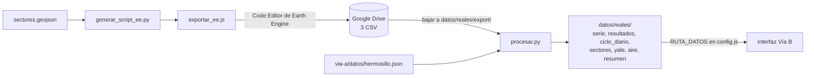

# Vía B · Procesamiento de datos

Lleva los datos de MODIS desde Earth Engine hasta los archivos que lee la interfaz (`via-b/`).



## Pasos con datos reales

1. **Generar el script** con los polígonos que se van a usar:
   ```bash
   python via-b/procesamiento/generar_script_ee.py                      # usa datos/prueba/sectores.geojson
   python via-b/procesamiento/generar_script_ee.py ruta/a/sectores.geojson
   ```
   Cada polígono necesita `id` y `tipo` (`sector` o `referencia`). Las referencias de desierto se llaman `RA` y `RB`.
2. **Correr en Earth Engine:** abrir <https://code.earthengine.google.com>, pegar todo `exportar_ee.js` y pulsar **Run**. Revisar en el mapa que los polígonos estén donde deben, y en la consola la muestra de filas.
3. En la pestaña **Tasks**, pulsar **Run** en las tres tareas: `suncity_lst`, `suncity_yale` y `suncity_extra`. Llegan a Google Drive, carpeta `SunCity`.
4. Bajar los tres CSV a `via-b/datos/reales/export/`.
5. **Procesar:**
   ```bash
   python via-b/procesamiento/procesar.py
   ```
   Lee `resumen.json`: trae los avisos (años sin cobertura, sectores sin cálculo, referencias con vegetación).
6. **Ver en la interfaz:** en `via-b/config.js` cambiar `RUTA_DATOS` a `'datos/reales/'`, correr `python servir.py` y abrir <http://localhost:8000/via-b/>.

## Qué hace cada archivo

| Archivo | Qué hace |
|---|---|
| `parametros.py` | Temporada, cobertura mínima, años mínimos, variantes y pasos del ciclo diario. Cada valor está en `docs/DECISIONES.md` |
| `plantilla_ee.js` | Script de Earth Engine sin polígonos |
| `generar_script_ee.py` | Inserta polígonos y parámetros en la plantilla y escribe `exportar_ee.js` |
| `exportar_ee.js` | Listo para pegar en el Code Editor (generado; no editar a mano) |
| `procesar.py` | Export de Earth Engine → archivos de la interfaz |
| `simular_export.py` | Export **simulado** con las columnas exactas, para probar sin cuenta de Earth Engine |
| `probar_procesamiento.py` | Prueba de punta a punta: simulación → procesamiento → comprobaciones |

## Qué exporta Earth Engine

Para cada polígono, año (2001-2025) y producto, la media de la temporada sobre los píxeles válidos:

| Producto | Colección | Paso | Calidad que se conserva |
|---|---|---|---|
| `MOD11_Terra_dia` / `_noche` | `MODIS/061/MOD11A2` | 10:30 / 22:30 | bits 0-1 = 0, o = 1 con bits 6-7 ≤ 1 |
| `MOD11_Aqua_dia` / `_noche` | `MODIS/061/MYD11A2` | 13:30 / 01:30 | igual |
| `MOD21_Terra_dia` / `_noche` | `MODIS/061/MOD21A1D` / `MOD21A1N` | 10:30 / 22:30 | bits 0-1 ≤ 1 |
| `MOD21_Aqua_dia` / `_noche` | `MODIS/061/MYD21A1D` / `MYD21A1N` | 13:30 / 01:30 | igual |

Además: Yale (`Daytime`, `Nighttime`, 2003-2018), población GPW 2020 y NDVI de la temporada (`MOD13A2`).

Colecciones, bandas y bits verificados en el catálogo de Earth Engine el 14 nov 2026. `MOD21` se exporta sin reescalar: `procesar.py` detecta si llega en kelvin o en enteros sin escalar.

## Qué escribe `procesar.py`

| Archivo | Contenido | Modelo |
|---|---|---|
| `serie.csv` | Diferencia nocturna sector − RA, MOD11 Terra, 2001-2025 (esquema de `datos/esquema.js`) | A |
| `resultados.csv` | Pendiente, intervalo, p de Mann-Kendall y Hamed-Rao, p y p FDR por sector y variante | B, C, D, E |
| `ciclo_diario.csv` | Media 2003-2019 de sector − RA en `terra_1030`, `aqua_1330`, `terra_2230` y `aqua_0130`, con MOD11 y MOD21, y el signo diurno de Yale (esquema de `datos/esquema.js`) | J |
| `sectores.geojson` | Polígonos con población 2020, NDVI, área y nivel (MOD11 y MOD21) | F |
| `yale.csv` | Diferencia nocturna propia junto a Yale día y noche, 2003-2018 | H |
| `aire.csv` | LST nocturna media de los sectores junto a `T2M_MIN` de POWER, y correlación en `resumen.json` | G |

Un sector con menos años válidos que el mínimo queda con celdas vacías en `resultados.csv`. La interfaz lo muestra en gris como "sin cálculo".

## Lo que falta

- Los polígonos: los de `datos/prueba/` son esquemáticos (Mario). Si se cambian, volver a generar el script.
- El zoom de ECOSTRESS (Modelo I) va por AppEEARS (D10) y no está en este flujo.
